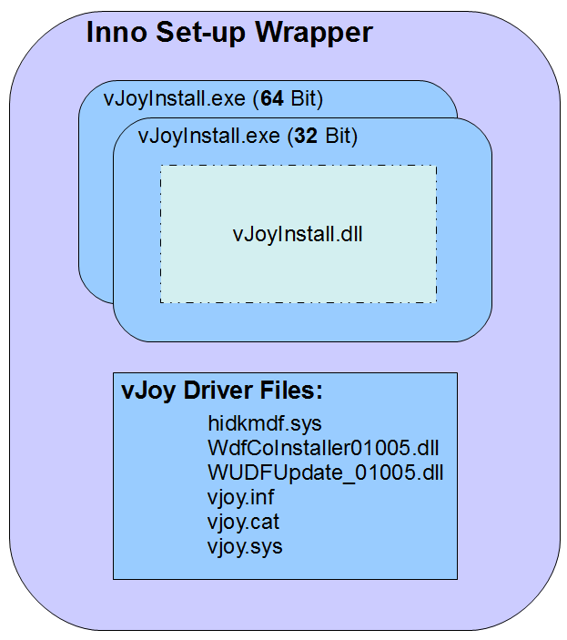

# Installer

https://web.archive.org/web/20180224082424/http://vjoystick.sourceforge.net/site/index.php/dev216/installer

## Description of supplied installer

The installation packages currently shipped (x86/x64) are constructed of several layers:



### Inno Set-up Wrapper:

This executable includes all the files needed for installation of vJoy device driver on both (x86/x64) environments. When executed the relevant files are extracted to a folder, a vJoy entry that includes an un-installer, is added to the system menu and vJoyInstall is called to perform the installation. This file created by [inno Setup](https://jrsoftware.org/isinfo.php) 🔗 from a script that is part of the code database (look for file _vJoyInstallerSigned.iss_).

### vJoy Driver Files

These are files that are required by the architecture for the driver to be installed properly. They consist of:

- **vjoy.sys** vJoy driver
- **vjoy.inf** Set-up information
- **vjoy.cat** Security catalogue (Created automatically during code build)
- **hidkmdf.sys** Filter driver for HID-KMDF interface (by Microsoft)
- **WdfCoInstaller01005.dll** WDF co-installer version 1.5   (by Microsoft)
- **WUDFUpdate_01005.dll** WDF Update to co-installer version 1.5   (by Microsoft)

### vJoyInstall.exe
This executable encapsulates the functionality of file vJoyInstall.dll - it is called by the wrapper to perform the actual installation of vJoy and writes the installation log to file vJoyInstall.log in the current directory. It is possible to use this file outside the wrapper as long as all vJoy Driver Files are present in the same folder.

**Note**: In the current version, the functionality of vJoyInstall.dll is statically linked to vJoyInstall.exe.

### vJoyInstall.dll

The vJoy Driver files are installed using an installer. The complex installation logic is within the Installation DLL (vJoyInstall.dll) that exposes the following set of interface functions:

```c
/* Get the name of the .INF file */
BOOL WINAPI  get_inf_file(TCHAR * InfFile);

/*  Get the vJoy device Hardware ID */
BOOL WINAPI  get_dev_hwid(TCHAR * DeviceHWID);

/* Check if vJoy already installed */
BOOL WINAPI is_vjoy_installed(void);

/* Repair the installed vJoy driver (Given the INF file and the Hardware ID)  */
BOOL WINAPI  repair(TCHAR * DeviceHWID, TCHAR * InfFile);

/* Install  vJoy driver (Given the INF file and the Hardware ID)  */
int WINAPI  installation(TCHAR * DeviceHWID, TCHAR * InfFile);

/* Remove  the installed vJoy driver (Given the INF file and the Hardware ID)
There is an option to delete all related files from the system (DelInf=TRUE) */
int WINAPI  removal(TCHAR * DeviceHWID, TCHAR * InfFile, BOOL DelInf);

/* Enable the installed vJoy driver (Given the driver's Revision number) */
BOOL WINAPI enable(USHORT Revision)

/* Disable the installed vJoy driver (Given the driver's Revision number) */
BOOL WINAPI disable(USHORT Revision)
```

There are additional interface files but you will probably won't need them.