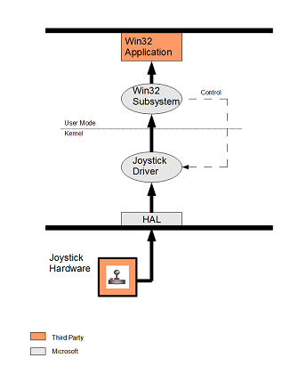
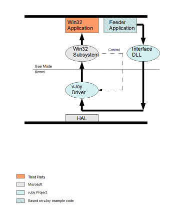

# System Architecture

https://web.archive.org/web/20180222135551/http://vjoystick.sourceforge.net/site/index.php/dev216/system-architecture

## Standard versus Virtual Joystick

To better understand how vJoy devices function in Windows environment, I wish do compare a system with a Standard Joystick device to a system where a vJoy device driver is installed:

## Standard Joystick

_Figure 1: System with Standard Joystick_

_Figure 1_ describes a system with a **standard joystick** hardware. The joystick position is sent from the hardware through the HAL (Hardware Abstraction Layer) to the standard MS joystick driver. Whenever the Win32 application (e.g. simulator) polls Win32 sub-system for position data, the subsystem issues a request to the driver and the driver returns the most updated position data. Since the driver exposes the joystick device as a standard `hid_device_system_game`, the communication with the driver is well defined.

The Joystick Driver can create a separate `hid_device_system_game` device for every newly connected hardware up to the limit of 16 devices. Each device is attributed serial number. The joystick device' attributes such as Number of buttons, axes, axis-range and many others are sent by the hardware device to the driver when the hardware is connected or when the driver is installed or enabled. The driver uses these attributes when it creates an `hid_device_system_game` device. When an application needs to get information about a specific device it gets it through the Win32 sub-system.

## Virtual Joystick

_Fig2: System with vJoy_

_Figure 2_ describes a system with **vJoy driver** and virtual device. Since vJoy device driver exposes the virtual joystick device as a standard `hid_device_system_game`, the Win32 sub-system and the applications see the virtual device as a standard joystick device. The main difference between vJoy driver and a standard driver lies in the source of the position data and the source of the device's attributes.

The position data is fed into the virtual device from a **feeder** that can be any software entity  (Application, service, another driver) that interfaces with the virtual device through a well-defined protocol.  It is strongly advised to interface <ins>indirectly</ins> through _vJoyInterface.dll_ library.  The details of the protocol are in article [Writing a feeder application](writing-a-feeder-application.md).

By default, the vJoy driver creates one `hid_device_system_game` device when installed. The attributes of this virtual device are hard-coded in vJoy driver. Replacing the default virtual device with up to 16 configurable virtual devices is optional.

## Force Feedback

Some physical joysticks support Force Feedback (FFB).
Such hardware devices are capable of giving the user feedback in the form of physical effect such as vibration of the joystick, change in resisting force and other effects.

The command to apply such effects is sent to the hardware from the application that it is associated with. An application that supports FFB queries the associated hardware for its FFB-capabilities before it starts sending the effects to be performed.

A _vJoy device_ may be configured to support most FFB effects. It may be configured to support all available effects, some or none.

Since vJoy devices are virtual devices, they cannot themselves perform the physical FFB effects. The effects are treated by software element called a _Receptor_.

## Feeder

In most cases, the only software you will need to write will be a _Feeder_.
If you need to support FFB then the feeder should also include a _Receptor_ unit.

### Role of feeder
The feeder rôle is to update the virtual device every time the position of the virtual joystick has changed. This is done through a small set of exposed interface functions. For simplicity sake we'll assume that one feeder feeds one virtual device. However, a feeder may feed one or more virtual devices – each with its own position data. A feeder should interact with the virtual device indirectly through the vJoy interface library (vJoyInterface.dll).

The feeder may or may not request general vJoy driver information. It is advisable that the feeder request information about the virtual device it feeds but this is not a requirement.

The feeder may monitor the result of its effort to update a virtual device, this way it will discover when a device was removed or disabled. Though the feeder is not required to take any action in such cases, it is useful to know that a virtual is not available any-more for further action such as notification or re-establishment of the connection.

### Receptor

The receptor is an optional unit of the _Feeder_.
The FFB data packets sent by the application are detected by the receptor and treated there. In most cases, the receptor filters, manipulate and passes the data packets on to some physical device.
The physical device then plays the effects.

### vJoy Interface DLL

When your feeder loads this DLL, a hidden window is created. When the feeder establishes a connection with one of the virtual devices, this window is defined as the target to the virtual device interface notifications. Later, if a virtual device is disabled (or removed), the hidden window receives a notification and releases the virtual device. The next time the feeder will attempt to write to the disabled device, the vJoy Interface will return an error. By this mechanism the DLL prevents locking-up of the virtual device by command-line feeder (and ill-written feeders) and simplifies the task of writing a feeder.