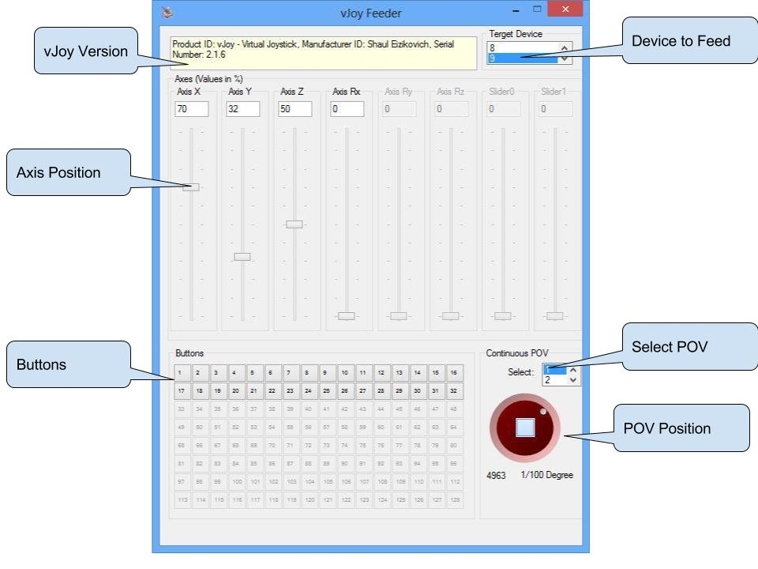

# vJoyFeeder

https://web.archive.org/web/20180327133240/http://vjoystick.sourceforge.net/site/index.php/utilities-218/vjoyfeeder

vJoyFeeder demonstrates the capabilities of vJoy and the usage of the API.

Use it to test vJoy Installation or while writing your own Feeder.

## Usage

Select a Target Device - vJoyFeeder will acquire this device (if free).

**Axes**: 

- Only the sliders for the axes that were configured are active. 
- For a given axis, slide up and down to change axis position.

**Buttons**:

- Only the buttons that were configured will be active.
- Click on an active button to toggle its position.

**POV Switches**:

- The type of the POV will appear on the POV frame (Continuous/Discrete)
- Select the POV you want to manipulate (There are up to 4)
- Turn the knob to the correct position.
- The current POV position (In 1/100 Degree units) will show below.
- Click the centre to set in/out neutral position.